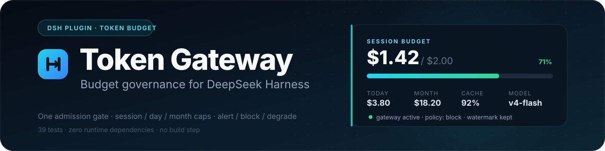
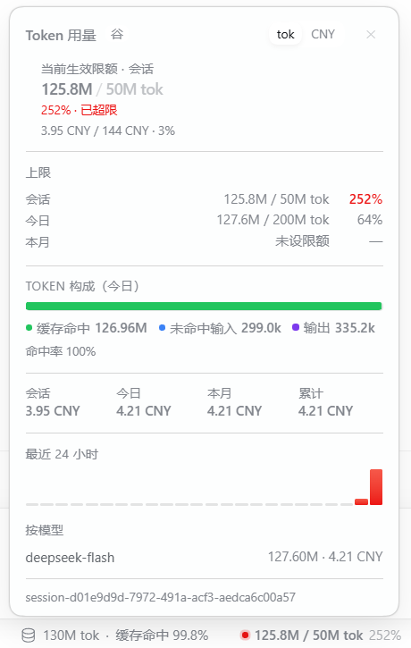
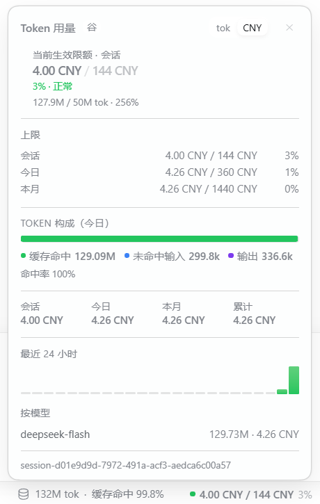
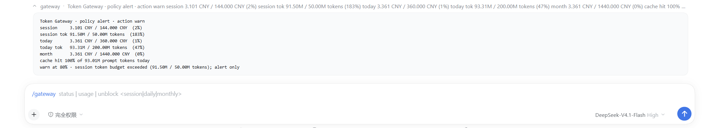
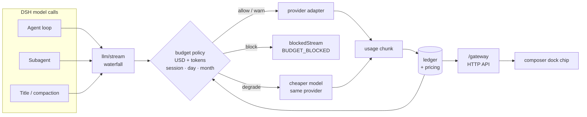

<p align="center">
  
</p>

<h1 align="center">dsh-token-gateway</h1>

<p align="center">

  <strong>把 DSH 的每一次模型调用，收口到一个预算网关。</strong><br>
  <sub>One admission gate · USD + token budgets · cost attribution · alert / block / degrade · in-composer panel</sub>
</p>

<p align="center">
  <a href="LICENSE"></a>
  <a href="test/"></a>
  <a href="package.json">= 22.19"></a>
  <a href="package.json"></a>
  <a href="#贡献"></a>
</p>

<p align="center">
  <a href="#效果图">效果图</a> ·
  <a href="#快速开始">快速开始</a> ·
  <a href="#预算策略">预算策略</a> ·
  <a href="#控制面">控制面</a> ·
  <a href="#架构图">架构图</a> ·
  <a href="#计价与归属">计价与归属</a>
</p>

---

DSH 的所有模型调用——主循环、子代理、会话标题、压缩摘要——都会经过 `llm/stream`。这个插件在那个接缝上放了一道闸门：**先算预算，再放行；放行后按 usage 记账；超了按策略预警、拦截或降级。**

- **零运行时依赖、零构建**：纯 JS，改完即加载；连浏览器面板都是手写的产物
- **两个维度、三档 scope**：USD 与 token 各自独立设限，会话 / 当日 / 当月
- **可审计**：按模型、缓存命中率、小时序列归属花费
- **有面板**：输入框下方一行 chip，点开是完整用量卡片
- **有控制面**：`/gateway` 命令 + `/token-gateway/v1/*` HTTP API

---

## 效果图

点开是完整用量卡片。同一块面板，左边按 token 显示，右边按金额显示：

<table>
  <tr>
    <td align="center"></td>
    <td align="center"></td>
  </tr>
</table>

也可以直接用 `/gateway` 命令查看：

<p align="center">
  
</p>

---

## 快速开始

```bash
# 从 GitHub 安装（bundle patch 自动插入 profile）
dsh plugin --profile web add github:Yuaneen/dsh-token-gateway

# 重启 dsh web 后，在会话里：
/gateway
```

本地开发：

```bash
git clone https://github.com/Yuaneen/dsh-token-gateway.git
cd dsh-token-gateway
dsh plugin --profile web add .
```

默认配置开箱即用：会话 `$2`、当日 `$10`、当月 `$100`（USD），超限 `block`，控制面仅回环可访问。想改就编辑 profile 的 `cordis.patch.yml` 里 `id: token-gateway` 那条的 `config`——插件行是热重载的，**保存即生效，不用重启**。

面板会从固定路径自动发现 `gateway.basePath`，所以改挂载点不会让面板失联。如果设置了 `gateway.token`，首次打开面板粘贴同一个 token 即可；它只保存在当前浏览器的 `localStorage`，不会由 Host 注入页面。

验证控制面（端口换成你自己的 `dsh web` 端口）：

```bash
curl -s http://127.0.0.1:49844/token-gateway/v1/status | jq .data.action
# "allow"（新账本；随用量变为 warn / block）
```

> [!TIP]
> 把 `dsh web` 暴露到 LAN 或公网之前，务必设置 `gateway.token`。没有 token 时，控制面只接受回环地址。

---

## 预算策略

预算有**两个独立维度**：金额（`budgets`，按 USD 记账）和 token（`tokenBudgets`，总数含缓存命中）。两者各含会话 / 当日 / 当月三档 scope，**所有 (scope × 维度) 里占比最高的那个决定动作**——任一维度触顶就触发策略，不会被另一维度的余量掩盖。

| 条件 | `alert` | `block` | `degrade` |
|---|---|---|---|
| 所有 scope × 维度均低于 `warnRatio` | allow | allow | allow |
| 最高占比 ≥ `warnRatio`，未到 cap | warn | warn | `degradeAt: warn` 且存在映射 → degrade；否则 warn |
| 任一 scope ≥ cap | warn（`over: true`） | block | 存在映射 → degrade；否则 block |
| 用户执行 `unblock <scope>` | 记录 watermark | 在 watermark 之前不再 block | 同 block |

`unblock` 的语义是**按当前用量打一个水位线**：用量继续增长并越过水位线后会重新拦截，避免「解一次就永久失效」。它会同时打 USD 和 token 两个水位线，所以无论哪个维度拦的都能解开。`session` 的 watermark 按会话隔离，`daily` / `monthly` 按计费周期隔离——今天解开的 daily 不会抬高明天的上限，本月解开的 monthly 也不会带进下个月（升级后旧版本遗留的、没有周期维度的 daily/monthly 水位线会被丢弃，需要时重新执行一次 `unblock`）。

`degradation` 按**模型名**映射到更便宜的模型，例如：

```yaml
degradation:
  deepseek-v4-pro: deepseek-v4-flash
```

跨 provider 的上下文窗口、工具 schema、视觉能力都可能不同，本版不做。

---

## 控制面

### `/gateway` 命令

```text
/gateway                 # 会话/今日/本月花费 + 当前策略
/gateway usage           # token 分项 + 按模型归属（Top 10）
/gateway unblock session # 解除当前水位线之前的 session block
/gateway help
```

### HTTP API

挂载在 `gateway.basePath`（默认 `/token-gateway`），只注册一个 prefix 路由：

| 方法 | 路径 | 说明 |
|---|---|---|
| `GET` | `/v1/status?session=<id>` | 预算 / 花费 / 策略 / 覆盖水位 |
| `GET` | `/v1/usage?session=<id>` | 花费 + token 分项 + 按模型归属 |
| `GET` | `/v1/stats?session=<id>&hours=24` | 面板用的完整快照：token 分项、缓存命中率、USD/token 两套 ratio、小时序列、累计 |
| `GET` | `/v1/series?hours=24` | 只要滚动小时序列 |
| `POST` | `/v1/unblock` | body `{ scope, sessionId? }` |

安全默认值：

- `gateway.token` 为空时，只允许回环地址（`127.0.0.1` / `::1` / IPv4-mapped）访问，且 `Host` 必须是 `127.0.0.1` / `localhost` / `::1`（自定义主机名请设置 token）——这同时挡住 DNS rebinding
- 配置 token 后，除固定的客户端 bootstrap（只返回 `basePath` 和是否需要 token）外，所有 API 请求必须带 `Authorization: Bearer <token>`（constant-time 比较）；面板首次打开会提示粘贴该 token，并保存在当前浏览器的 `localStorage`
- 面板通过 `/_dsh-token-gateway/config` 发现挂载点；该响应不含花费、会话或凭据数据
- token 会随 `Authorization` 头从浏览器发到 Host；远程访问请使用 HTTPS
- 写操作只有 `unblock`，只接受 `application/json`，并拒绝跨站 `Origin` / `Sec-Fetch-Site`（简单表单 CSRF）
- 反代 / 隧道场景必须设置 token：loopback 判断只看直连 socket，不会信任 `X-Forwarded-For`

实测：

```text
GET  /token-gateway/v1/status  -> 200 {"ok":true,...}
GET  /token-gateway/v1/stats   -> 200 {"ok":true,"data":{"tokenTotals":...}}
POST /token-gateway/v1/unblock -> 200 {"ok":true,"scope":"session"...}
```

---

## 架构图



所以这里的「网关」是 **DSH 模型调用的统一准入层**，而不是另起一个 LiteLLM 式的独立代理进程。对外 OpenAI 兼容入口尚未实现，将来会复用同一套预算与账本。

为什么不用 `agent/request`：该接缝已标记 deprecated，且明确要求不能改 provider/model（只能改 controls）。`llm/stream` 才是覆盖全部调用、且能在 `next()` 之前拦截的地方。

---

## 计价与归属

- DSH 的 `TokenUsage` 四个桶是**互斥**的：`inputTokens`（未缓存输入）、`cacheReadTokens`、`cacheWriteTokens`、`outputTokens`。每个桶只计一次价。
- 内置价格表是 USD / 1M tokens 的**峰时快照**，口径为 2026-11 峰时价目；谷时乘以 `offPeakMultiplier`（默认 `0.5`）。上生产前请对照官方价目页，用 `pricing.prices` 覆盖。
- `pricing.prices` 的条目会**与内置表按模型合并**：只写 `input` / `output` 时，`cacheRead` / `cacheWrite` 仍保留内置价，不会回退到 `input` 价。只为内置表里没有的模型写 override 时，缺失的 cache 桶才回退到该 override 的 `input`。
- 内置表覆盖 `deepseek-chat`、`deepseek-reasoner`、`deepseek-flash`、`deepseek-v4-flash*`、`deepseek-v4-pro`。其余模型走 `defaultPrice`；默认 `priced: false`，计 0 并在日志里告警一次。
- 归属精度：
  - `llm/stream` 的 `usage` 是权威来源
  - 带 `sessionId` 的调用记到该会话
  - 不带 `sessionId` 的辅助调用（标题 / 压缩）回退到最近活跃会话，再回退到 `__global__`；子代理会话不会抢走这个回退归属
  - 重试的每次尝试各自计量（provider 实际计费）

实测口径校验（真实一次调用：89216 cacheRead + 323 input + 707 output，谷时）：

```text
(89216 × 0.0056 + 707 × 1.12 + 323 × 0.28) ÷ 1M  →  × 0.5  =  $0.000691
```

与账本 `totals.session` 完全一致。

### 持久化

`src/store.js` 把账本序列化为 JSON：

- 进程内 Map → `serialize()` → 原子写（`tmp` + `rename`，`0600`）
- 写入防抖 `persistence.flushMs`，插件 dispose 时强制 flush
- 启动时 `restore()` 逐桶校验，损坏的桶忽略；旧版本快照（无小时序列）也能恢复
- 未启用持久化时退化为纯内存（重启归零）
- 小时序列保留 8 天，日桶上限 400 天

---

## 贡献

欢迎 issue / PR。提交前请确保：

```bash
npm run verify
```

如果新增配置字段，请同步更新 `src/config.js` 的校验与 `cordis.patch.yml` 的示例。

---

## License

MIT © 2026 DSH Market contributors
