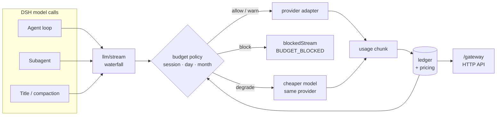

<p align="center">
  
</p>

<h1 align="center">dsh-token-gateway</h1>

<p align="center">
  <strong>把 DSH 的每一次模型调用，收口到一个预算网关。</strong><br>
  <sub>One admission gate · three budget scopes · cost attribution · alert / block / degrade</sub>
</p>

<p align="center">
  <a href="LICENSE"></a>
  <a href="test/"></a>
  <a href="package.json">= 22.19"></a>
  <a href="package.json"></a>
  <a href="#路线图"></a>
  <a href="#贡献"></a>
</p>

<p align="center">
  <a href="#为什么是网关">为什么是网关</a> ·
  <a href="#快速开始">快速开始</a> ·
  <a href="#预算策略">预算策略</a> ·
  <a href="#配置">配置</a> ·
  <a href="#控制面">控制面</a> ·
  <a href="#路线图">路线图</a> ·
  <a href="#已知限制">已知限制</a>
</p>

---

> [!NOTE]
> **v0.1 MVP，可运行、可测试、可扩展。** 39 个测试全部通过，并已在隔离的 DSH `0.2.2-rc.1` web profile 中实际启动：`GET /token-gateway/v1/status` 返回 `200`。客户端 UI 与对外 OpenAI 兼容入口在[路线图](#路线图)里。

DSH 的所有模型调用——主循环、子代理、会话标题、压缩摘要——都会经过 `llm/stream`。这个插件在那个接缝上放了一道闸门：**先算预算，再放行；放行后按 usage 记账；超了按策略预警、拦截或降级。**

- **零运行时依赖**，无 TypeScript 构建，改完即可加载
- **三档预算**：会话 / 当日 / 当月，USD 记账，按配置币种展示
- **可审计**：按模型、会话、日、月归属花费
- **有控制面**：`/gateway` 命令 + `/token-gateway/v1/*` HTTP API

---

## 为什么是网关



所以这里的「网关」是 **DSH 模型调用的统一准入层**，而不是另起一个 LiteLLM 式的独立代理进程。对外 OpenAI 兼容入口放在 v0.3，它复用同一套预算与账本。

为什么不用 `agent/request`：该接缝已标记 deprecated，且明确要求不能改 provider/model（只能改 controls）。`llm/stream` 才是覆盖全部调用、且能在 `next()` 之前拦截的地方。

### 一次调用的决策

```text
onLlmStream(options, next)
  ├─ 已降级请求？ ── 是 ──▶ 只计量（防止再次准入造成循环）
  ├─ sessionId = options.sessionId ?? lastSessionId ?? "__global__"
  ├─ totals    = ledger.totals(sessionId, now)
  ├─ decision  = evaluateBudget(totals, budgets, overrides, model)
  │
  ├─ block   ──▶ blockedStream(原因 + /gateway unblock 提示)
  ├─ degrade ──▶ llm.stream({ ...options, model: 更便宜模型 })
  │              └─ 重新进入 waterfall，命中 rewritten 守卫，只计量
  ├─ warn    ──▶ 冷却窗口内记一条日志，然后正常放行
  └─ allow   ──▶ next()
                   └─ 第一个 usage chunk：
                        price = priceForModel(route, now)
                        cost  = costOf(usage, price)
                        ledger.record(...)
```

三个工程细节：

| 细节 | 做法 |
|---|---|
| **阻塞不抛错** | 返回正常的 assistant 文本流 + `finish { kind: 'error', failure.code: 'BUDGET_BLOCKED' }`，让 agent loop 正常结算，不触发传输重试 |
| **降级不递归** | 被降级的请求对象放进 `WeakSet`，重新进入 waterfall 时跳过准入、只计量 |
| **计量不编造** | provider 没回 `usage` 的失败调用不计费，不用字符数瞎估 |

---

## 快速开始

```bash
# 从 GitHub 安装（bundle patch 自动插入 profile）
dsh plugin --profile web add github:Yuaneen/dsh-token-gateway

# 重启 dsh web 后，在会话里：
/gateway
```

本地开发：

```bash
git clone https://github.com/Yuaneen/dsh-token-gateway.git
cd dsh-token-gateway
dsh plugin --profile web add .
```

默认配置开箱即用：会话 `$2`、当日 `$10`、当月 `$100`（USD），超限 `block`，只读控制面仅回环可访问。想改就编辑 profile 的 `cordis.patch.yml`（完整字段见[配置](#配置)）。

验证控制面：

```bash
curl -s http://127.0.0.1:3080/token-gateway/v1/status | jq .data.action
# "allow"
```

> [!TIP]
> 把 `dsh web` 暴露到 LAN 或公网之前，务必设置 `gateway.token`。没有 token 时，控制面只接受回环地址。

---

## 预算策略

| 条件 | `alert` | `block` | `degrade` |
|---|---|---|---|
| 所有 scope 均低于 `warnRatio` | allow | allow | allow |
| 最高 scope ≥ `warnRatio`，未到 cap | warn | warn | `degradeAt: warn` 且存在映射 → degrade；否则 warn |
| 任一 scope ≥ cap | warn（`over: true`） | block | 存在映射 → degrade；否则 block |
| 用户执行 `unblock <scope>` | 记录 watermark | 在 watermark 之前不再 block | 同 block |

`unblock` 的语义是**按当前花费打一个水位线**：花费继续增长并越过水位线后会重新拦截，避免“解一次就永久失效”。`session` 的 watermark 按会话隔离，`daily` / `monthly` 是全局的。

`degradation` 只允许同 provider 的模型映射，例如：

```yaml
degradation:
  deepseek-v4-pro: deepseek-v4-flash
```

跨 provider 的上下文窗口、工具 schema、视觉能力都可能不同，MVP 不做。

---

## 配置

所有字段在 [`src/config.js`](src/config.js) 中校验，非法值直接让插件加载失败（**fail loud**，不静默关掉预算）。

| 字段 | 默认 | 说明 |
|---|---|---|
| `budgets.session/daily/monthly` | `2 / 10 / 100` USD | `null` 为不限；`0` 被拒绝（不是合法的 cap） |
| `warnRatio` | `0.8` | 首次预警比例 |
| `overLimit` | `block` | `alert` / `block` / `degrade` |
| `degradation` | `{}` | 模型 → 更便宜的同 provider 模型 |
| `degradeAt` | `warn` | 仅 `degrade` 生效：warn 阶段还是 hard 阶段开始降级 |
| `pricing.prices` | `{}` | 覆盖内置价格表，key 支持 `model` 或 `provider/model` |
| `pricing.defaultPrice` | 见源码 | 未定价模型的兜底；`priced: false` 时按 0 计入 |
| `pricing.peak.windows` | 工作日两段 | 可自定义星期/时段 |
| `pricing.peak.holidays` | `[]` | `YYYY-MM-DD`，全天谷价 |
| `gateway.http` | `true` | 是否注册控制面 |
| `gateway.token` | `''` | 空 = 仅回环；非空 = 所有请求需 Bearer |
| `persistence.file` | `$DSH_HOME/token-gateway/ledger.json` | 支持 `~` / `$DSH_HOME` |

<details>
<summary><strong>完整配置示例</strong>（点击展开）</summary>

```yaml
- insert:
    - id: token-gateway
      name: dsh-token-gateway
      config:
        budgets:
          session: 2      # USD；null/省略 = 不限
          daily: 10
          monthly: 100
        warnRatio: 0.8
        overLimit: block  # alert | block | degrade
        degradation:
          deepseek-v4-pro: deepseek-v4-flash
        degradeAt: warn   # warn | hard
        currency: { code: CNY, rate: 7.2, decimals: 3 }
        pricing:
          prices: {}      # USD / 1M tokens，覆盖内置快照
          peak:
            enabled: true
            timeZone: Asia/Shanghai
            offPeakMultiplier: 0.5
        gateway:
          http: true
          basePath: /token-gateway
          token: ''       # 非空时所有控制面请求需 Bearer
        persistence:
          enabled: true
          file: $DSH_HOME/token-gateway/ledger.json
          flushMs: 500
```

</details>

---

## 控制面

### `/gateway` 命令

```text
/gateway                 # 会话/今日/本月花费 + 当前策略
/gateway usage           # 按模型归属（Top 10）
/gateway unblock session # 解除当前水位线之前的 session block
/gateway help
```

### HTTP API

挂载在 `gateway.basePath`（默认 `/token-gateway`），只注册一个 prefix 路由：

| 方法 | 路径 | 说明 |
|---|---|---|
| `GET` | `/v1/status?session=<id>` | 预算 / 花费 / 策略 / 覆盖水位 |
| `GET` | `/v1/usage?session=<id>` | 花费 + 按模型归属 |
| `POST` | `/v1/unblock` | body `{ scope, sessionId? }` |

安全默认值：

- `gateway.token` 为空时，只允许回环地址（`127.0.0.1` / `::1` / IPv4-mapped）访问
- 配置 token 后，所有请求必须带 `Authorization: Bearer <token>`
- 写操作只有 `unblock`，且同样是幂等水位线语义

实测（隔离 profile，`--port 0`）：

```text
GET  /token-gateway/v1/status  -> 200 {"ok":true,...}
GET  /token-gateway/v1/usage   -> 200 {"ok":true,"data":{"models":[]...}}
POST /token-gateway/v1/unblock -> 200 {"ok":true,"scope":"session"...}
```

---

## 计价与归属

- DSH 的 `TokenUsage` 四个桶是**互斥**的：`inputTokens`（未缓存输入）、`cacheReadTokens`、`cacheWriteTokens`、`outputTokens`。每个桶只计一次价。
- 内置价格表是 USD / 1M tokens 的**峰时快照**，口径为 2026-11 峰时价目；谷时乘以 `offPeakMultiplier`（默认 `0.5`）。上生产前请对照官方价目页，用 `pricing.prices` 覆盖。
- 内置表覆盖 `deepseek-chat`、`deepseek-reasoner`、`deepseek-flash`、`deepseek-v4-flash*`、`deepseek-v4-pro`。其余模型走 `defaultPrice`；默认 `priced: false`，计 0 并在日志里告警一次。
- 归属精度：
  - `llm/stream` 的 `usage` 是权威来源
  - 带 `sessionId` 的调用记到该会话
  - 不带 `sessionId` 的辅助调用（标题 / 压缩）回退到最近活跃会话，再回退到 `__global__`
  - 重试的每次尝试各自计量（provider 实际计费）

### 持久化

`src/store.js` 把账本序列化为 JSON：

- 进程内 Map → `serialize()` → 原子写（`tmp` + `rename`，`0600`）
- 写入防抖 `persistence.flushMs`，插件 dispose 时强制 flush
- 启动时 `restore()` 逐桶校验，损坏的桶忽略，不阻塞启动
- 未启用持久化时退化为纯内存（重启归零）

---

## 路线图

### v0.2 — 可日常使用

- [ ] 客户端状态胶囊 + 设置页（沿用官方 `slots` / settings 接缝）
- [ ] 按 provider 的预算上限
- [ ] 用 `storage-domain` 替代手写 JSON
- [ ] 审计事件（block / degrade / unblock）写入会话日志或独立账本

### v0.3 — 对外 Token Gateway

- [ ] `POST /v1/chat/completions`、`/v1/messages`（OpenAI / Anthropic 兼容）
- [ ] API key → 租户 / 配额映射，流式翻译，tool calls
- [ ] 复用同一 `Ledger` 与 `evaluateBudget`，按 key 加一层 `tenant` scope

### v0.4 — 优化

- [ ] 在 `agent/pre-step` 用 `agent.model.select()` 做按任务分级路由（而不是只在 `llm/stream` 里事后改模型）
- [ ] 前缀缓存友好：稳定 system / tools 前缀，减少 cache miss
- [ ] 峰谷调度：高峰只拦“可延后”的任务，谷时自动续跑

---

## 已知限制

> [!WARNING]
> 这是 MVP，不是生产级计费系统。下面几条请在采用前逐条确认。

1. **降级发生在请求头记录之后**：会话日志的 `request/header` 仍记录原模型，账本按实际下发的便宜模型计。两者可能不一致。缓解：只做同 family 映射，记录审计日志；v0.4 把路由前移到 `agent/pre-step`。
2. **工具调用费用未计**：DeepSeek 的 web search / fetch、文件解析等按次计费，不在 `TokenUsage` 里。
3. **`unblock` 是水位线，不是永久开关**：花费继续增长会重新拦截。
4. **辅助调用归属**：没有 `sessionId` 的调用可能落到最近活跃会话，严格审计场景应改为 `__global__`。
5. **HTTP 默认仅回环**：把 `dsh web` 暴露到 LAN 前务必设置 `gateway.token`。
6. **价格表是快照**：内置数字仅作起点，生产前用官方价目覆盖。
7. **进程内聚合 + JSON 持久化**：多进程 / 多实例部署时账本不共享；v0.3 的多租户入口需要外部存储。

---

## 开发

```bash
node --test test/*.test.js   # 39 tests
npm run check                # node --check 全部源码
```

```text
.
├── package.json          # dsh.bundle.patch + engines
├── cordis.patch.yml      # 默认配置 / profile 插入行
├── docs/
│   └── banner.svg        # README 头图
├── src/
│   ├── index.js          # cordis 接线（llm/stream, commands, webServer）
│   ├── gateway.js        # 准入、计量、控制面核心（可脱离 cordis 测试）
│   ├── config.js         # 默认值 + 严格校验
│   ├── pricing.js        # 价格表、峰谷、金额格式化
│   ├── policy.js         # 纯预算决策引擎
│   ├── ledger.js         # 会话/日/月/模型账本
│   ├── store.js          # 原子 JSON 持久化
│   └── stream.js         # 阻塞流 + usage 旁路计量
└── test/                 # 39 个测试（含假 ctx 的端到端接线）
```

架构上刻意把 **cordis 接线**（`index.js`）与 **纯逻辑**（`policy.js` / `ledger.js` / `pricing.js`）分开，前者只负责生命周期，后者可以脱离宿主直接测试。

---

## 贡献

欢迎 issue / PR。提交前请确保：

```bash
node --test test/*.test.js && npm run check
```

如果新增配置字段，请同步更新 `src/config.js` 的校验、`cordis.patch.yml` 的示例，以及本 README 的字段表。

---

## License

MIT © 2026 DSH Market contributors
